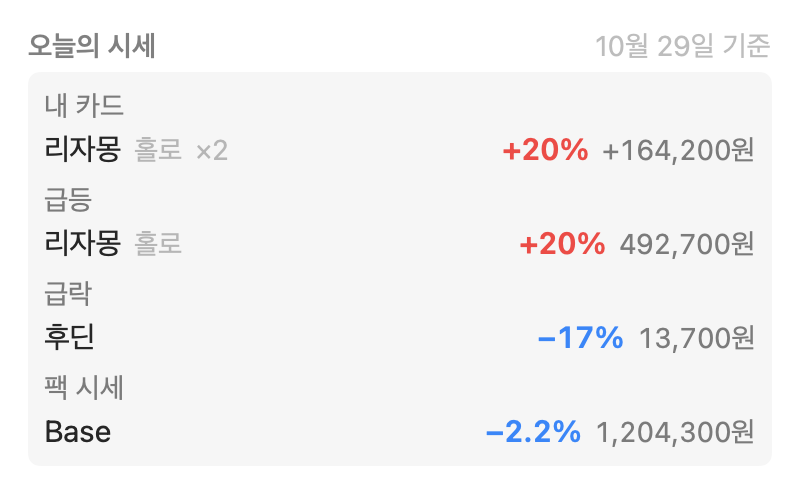
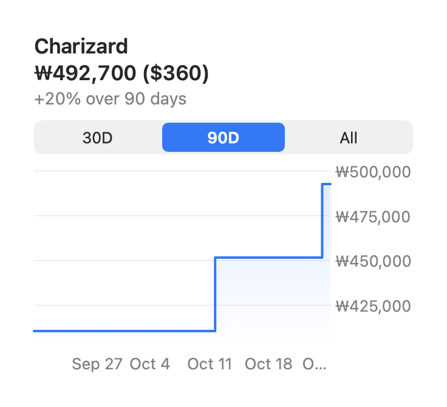
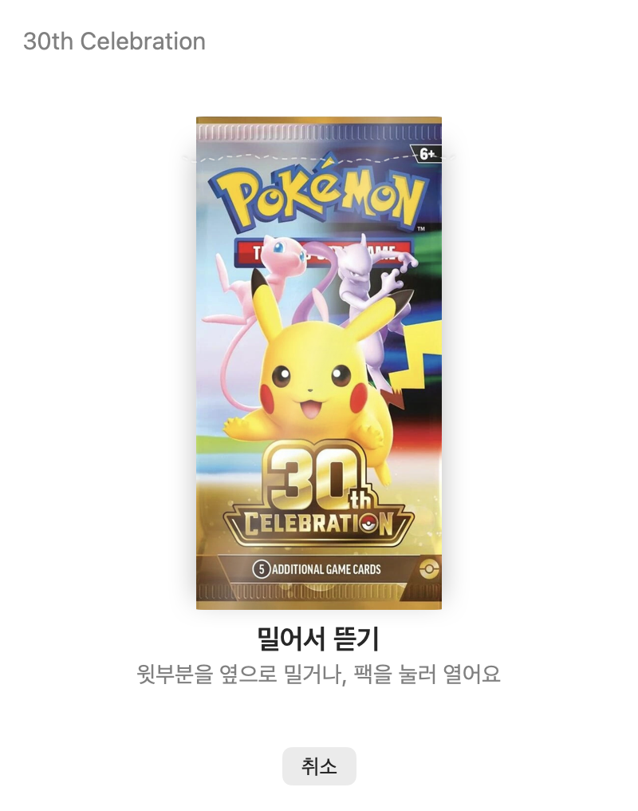
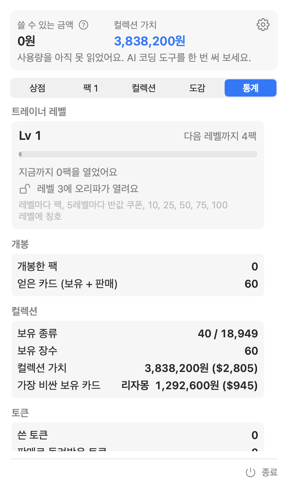

# PokePackBar

AI 코딩 도구로 태운 토큰을 포켓몬 카드팩으로 바꿔 주는 macOS 메뉴바 앱.

코딩하면 토큰이 쌓이고, 쌓인 토큰으로 카드팩을 산다. 팩을 뜯어 카드를 모은다.

## 어떻게 동작하나

Claude Code, Codex, Gemini CLI 등 11개 도구의 로컬 로그에서 사용량을 읽는다.
로컬 모드는 사용량을 기기 안에서 처리한다. 온라인 계정을 연결하면 누적 사용량과
게임 명령을 서버로 보내 카드·팩·재화를 기기 사이에서 공유한다. 공급자 원본 로그와
인증 토큰은 서버로 보내지 않는다.

- **상점** — 세트별 카드팩을 산다(1999년 초판부터 최신 세트까지 127종).
  **오리파**는 여러 세트의 상위 등급만 골라 담은 40봉투짜리 박스다. 안에 무엇이 남았는지
  전부 보이고, **봉투를 직접 골라** 연다. 연 봉투의 카드는 박스에서 빠지고, 값은 남은
  봉투에 따라 바뀐다
- **팩** — 산 팩을 뜯는다. 한 장씩 크게 나오고, 등급에 따라 카드 뒤에서 빛이 퍼진다.
  세트별 슬롯과 판형 규칙을 사용하며, **갓팩**은 지원되는 제품별 규칙에 따라 나온다.
  보유 팩 수량을 입력해 한 번에 개봉할 수 있다
- **컬렉션** — 모은 카드를 본다. 세트와 등급으로 거르고, 눌러서 크게 본다.
  이름·카드 번호로 검색하고 번호순으로 정렬할 수 있다.
  크게 본 카드는 마우스로 기울일 수 있고, 기울이는 방향에 따라 광택이 흐른다
- **도감** — 카드 몇 장을 묶은 조합을 완성한다. 「불꽃도마뱀의 성장기」, 「로켓단 독가스반」처럼
  다양한 조합이 있고, 다 모으면 팩과 영구 혜택(적립 증가·팩 할인 등)을 받는다
- **통계** — 개봉·보유·판매 기록과 컬렉션 가치를 확인한다. 특수팩·최고 가치 팩은
  저장된 최근 1,000팩 기록을 기준으로 표시한다

공식 사용 한도(5시간·주간)를 다 채우면 세트별 팩값에 맞춘 보너스 팩을 받는다.

등급은 국내 커뮤니티에서 쓰는 약칭을 따른다 — C · U · R · RR · RRR · AR · SR · SAR · UR.

## 설치

```bash
brew tap wonyangs/tap
brew trust --cask wonyangs/tap/poke-pack-bar
brew install --cask poke-pack-bar
```

가운데 `brew trust` 는 건너뛸 수 없다. Homebrew 가 서드파티 tap 의 cask 를
기본으로 거부하므로, 없으면 설치가 막힌다.

macOS 14 이상.

업데이트는 앱 안의 업데이트 버튼을 누르거나 아래를 실행한다.

```bash
brew update
brew upgrade --cask poke-pack-bar
```

`brew update` 를 빼면 안 된다. Homebrew 는 tap 을 하루에 한 번만 다시 받으므로,
없으면 로컬에 남은 옛 cask 를 보고 "이미 최신" 이라고 답한다.

## 온라인 계정과 기존 데이터 이전

설정의 **계정 및 서버**에서 기본 주소 `https://ppb-api.wonyangs.com`을 사용한다.
새 가입과 기존 계정 연결을 구분해서 안내한다. 연결 코드는 운영자가 계정을
미리 만들었거나 기존 UUID 계정을 이어 쓸 때 사용한다. 초대제로 운영하는
서버에 연결하면 필요한 코드를 안내한다.
기존 사용자는 먼저 앱을 종료하고 `~/Library/Application Support/PokePackBar/game-state.json`
이전을 운영자와 진행한다. 원본 로그나 공급자 로그인 정보는 보내지 않는다.

운영자가 기존 상태를 가져온 뒤 발급한 코드를 가입 화면의 **기존 UUID 계정 연결**에
입력하고 이메일·비밀번호를 등록한다. 로그인 후 앱을 재시작하면 서버 상태로 연결된다.
다른 Mac에서는 같은 계정으로 로그인만 한다. 세이브는 자동 업로드하거나 합치지 않는다.

온라인에서는 통계·친구·교환·마켓·알림과 대량 개봉 작업을 별도 창에서 사용할 수 있다.
서버 연결이 끊기면 저장된 상태를 볼 수 있지만 구매·개봉·거래는 연결 복구 후 처리한다.
원래 로컬 세이브는 보존되며, 온라인과 로컬 플레이 결과를 나중에 자동 합산하지 않는다.


## 0.25.0

온라인 통계의 **오늘의 시세**에서 급등·급락·내 카드 변동을 보고, 카드·팩 상세의
그래프 버튼으로 30일·90일·전체 기록을 확인한다. 내 카드의 큰 상승은 하루 한 번 알린다.
로그아웃하면 내 카드 시세 캐시와 늦게 도착한 응답도 정리한다.

영구 혜택은 별 5개 조합에 집중하고 나머지 조합의 한 번 받는 보상을 올렸다.
토큰 획득 상한은 40%이며, 완성 수 225·275 계단을 추가했다. 기존 재화·카드·팩과
보상 수령 내역은 유지한다. 새 규칙을 사용하려면 온라인 기기를 0.25.0으로 업데이트한다.




## 0.24.0

서버 로그인 토큰을 이 Mac의 앱 전용 파일에 저장한다. 앱 실행·동기화·계정 창 열기는
키체인을 조회하지 않아 업데이트 뒤 반복되던 서버 로그인 승인 팝업을 없앴다.
비밀번호는 저장하지 않는다. 파일은 암호화하지 않으며 같은 macOS 사용자 권한으로
실행되는 프로그램에 대한 보호는 키체인보다 약하다.

기존 사용자는 계정 창의 **이전 로그인 가져오기**를 한 번 누르거나 다시 로그인한다.
가져올 때 macOS 승인이 한 번 필요할 수 있다. 이후 실행은 저장한 파일을 사용하고,
로그아웃·비밀번호 변경 시 서버의 세션 폐기와 로컬 파일 삭제를 유지한다.
예전 키체인 항목은 복구용으로 남겨두며 자동으로 다시 사용하지 않는다.


## 0.23.0

도감 보상을 연속으로 받아도 마지막 보상 배너가 자동으로 사라진다.
온라인 창의 교환·구매·판매 등록 축하 표시도 새 표시마다 타이머를 다시 시작한다.
게임 규칙·가격·로그인 정책은 유지한다.


## 0.22.0

카드 상세의 크기와 위치를 고정했다. 도감 배지나 보유 수, 판매 확인 상태에 따라
카드가 줄거나 오르내리지 않는다. 판매 확인은 해당 영역으로 스크롤하고,
1장 보유 문구는 영어·스페인어·프랑스어·포르투갈어에서 단수로 표시한다.

로그인 세션은 1년간 유효하며, 남은 기간이 반년 미만이면 사용 중 다시 1년으로 연장한다.
앱은 저장된 만료 시각 대신 서버 응답으로 유효성을 판단한다. 로그아웃·비밀번호 변경·
기기 세션 폐기는 유지하며, 이미 만료되거나 폐기된 세션은 다시 로그인해야 한다.
게임 규칙·가격·DB 스키마는 그대로다.


## 0.21.0

전체 도감을 350개로 늘렸다. 조합 223개는 별 1~5개로 묶어 보고, 검색하면 한 목록에서
찾는다. 최신 세트·서브세트와 고난도 조합을 추가하고 보상을 보강했다.
영구 혜택은 종류별 총량과 상한을 유지한 채 재분배하며, 기존 재화와 수령 내역은 보존한다.

교환 카드 선택 창에서 여러 종류와 장수를 한 번에 고른다. 카드 상세는 중복 카드가
있어도 같은 크기를 유지하며, 30주년 카드의 고운 반짝이를 복원했다.


서버와 도감 규칙 버전이 함께 바뀐다. **온라인 기기는 앱을 0.21.0으로 업데이트해야 한다.**
DB 스키마는 0009를 유지하며 기본 가격과 팩 봉입 규칙은 그대로다.

## 0.20.0

시대별 홀로 무늬·색·빛나는 영역을 보정했다. 포켓몬의 불투명 인쇄와 배경을 구분하고,
금색·리버스·글리터 재질과 특수 에너지의 포일 영역을 다듬었다.
기존 카드의 저장 판형과 시세, 계정·재화는 유지한다.

닉네임은 계정 창의 ‘프로필’ 탭에서 바꾼다. 온라인 창의 닉네임을 누르면 바로 열리며
공개 범위 설정을 유지한다. 앞에 열린 온라인 창에서 알림을 확인하거나 관련 교환·친구·
마켓 항목을 보면 자동으로 읽음 처리한다. 창을 떠나거나 로그아웃하면 처리를 멈춘다.


서버는 기존 `0408c1f`와 스키마 `20261015_0009`를 유지하며 기존 API로 연동한다.

## 0.19.0

교환 한쪽에 돈을 얹고, 트레이너 판매 글에 판매가의 절반 이상인 가격을 제안할 수 있다.
돈은 제안 중에 묶지 않으며 수락할 때 잔액·재고를 확인해 카드와 함께 정산한다.
받은 제안은 ‘내 판매’, 보낸 제안과 결과는 ‘보낸 제안’에서 확인한다.

큰 카드를 끌어 뒷면까지 돌려 볼 수 있다. 카드 상세에는 뽑힐 확률과 마켓 최저가,
위시리스트를 추가했다. 메뉴바의 점은 안 읽은 알림을 표시하며, 다른 계정으로
로그인하면 앱을 자동으로 다시 열어 그 계정으로 전환한다.
기존 계정·재화는 보존하고 서버 DB를 0009로 갱신한다.


## 0.18.0

로테이션은 온라인 마켓의 봇 매물로 통합했다. 매일 한국 시간 오전 9시에 20종을
갱신하며 각 5장, 계정당 한 장씩 살 수 있다. 판매자와 미보유 카드로 거르고,
카드 상세에서 마켓 판매로 바로 이동할 수 있다.

게임에 바로 팔면 시세의 50%에 도감 판매 혜택을 곱해 지급한다. 장당 최소
100원이며 팩 가격은 유지한다. 기존 계정·재화는 보존하고 DB를 0008로 갱신한다.
온라인 판매 견적과 로테이션 변경을 사용하려면 앱을 0.18.0으로 업데이트한다.


## 0.17.0

친구에게 남는 카드 중 내가 없는 카드를 교환 칸에서 바로 고를 수 있다.
친구 바인더에는 ‘내게 없는 카드만’ 필터와 미보유 표시를 추가했다.
컬렉션 전체의 가격순 정렬은 보유 여부와 관계없이 시세 순서를 따른다.
로그아웃 중 도착한 바인더 응답은 비워 둔 계정 캐시를 유지한다.

기존 계정·재화, 서버 DB 스키마와 게임 규칙 버전은 유지한다.


## 0.16.0

교환·마켓·친구 소식을 macOS 알림으로 받으며, 누르면 해당 항목으로 이동한다.
앱 실행 중 30초마다 확인하고 macOS 알림 권한과 설정의 온라인 알림 옵션을 사용한다.
알림 목록은 최신순이며 모두 읽음은 화면에 표시된 마지막 알림까지만 처리한다.

교환 카드에 시세를 표시하고 정렬하며, 친구 끊기·차단 전에 확인한다.
판형 장부 캐싱으로 일괄 판매 화면과 판매 계산의 반복 작업을 줄였다.
서버 DB 스키마·게임 규칙 버전과 기존 계정·재화는 유지한다.


## 0.15.0

팩 윗부분을 밀어 뜯는 연출, 팩 검색과 키보드 조작을 추가했다. 누적 개봉 수로
트레이너 레벨이 올라가며 팩·쿠폰·칭호를 받을 수 있다. 로테이션 마켓은 매일
한국 시간 오전 9시에 8장을 갱신한다. 친구의 교환 가능한 카드에서 제안하고
역제안으로 답할 수 있다.

운영 서버는 이메일과 비밀번호로 공개 가입할 수 있다. 연결 코드는 기존 계정이나
운영자가 미리 만든 계정을 연결할 때만 사용한다. 이메일 인증은 아직 지원하지 않는다.

세트별 실측 봉입률과 도감 보상도 갱신했다. 서버와 규칙 버전이 바뀌므로
온라인 사용자는 0.15.0으로 업데이트해야 한다. 기존 재화·카드·수령한 보상은 유지한다.




## 0.14.0

가입 화면에서 초대 코드와 기존 계정 연결의 용도를 설명하고, 붙여 넣은 코드의
앞뒤 공백·줄바꿈을 제거한다. 초대제 서버의 거절 응답도 필요한 코드 안내로 표시한다.


## 0.13.0

온라인 창과 계정·오류 안내를 6개 언어로 지원한다. 교환 제안의 빈 카드 전송 문제를
수정하고, 바인더 카드를 시세순으로 한 번에 고른 뒤 끌어서 순서를 바꿀 수 있다.
메뉴바에 답할 교환·친구 신청을 표시하며 검색 결과는 정확한 이름부터 보여 준다.
온라인 상태 변경분과 백그라운드 처리로 전송량과 화면 멈춤을 줄였다.
배포본은 고정 코드서명 인증서를 사용한다.


## 0.12.0

온라인 창을 마켓·교환·친구 중심으로 개편하고 요청 번호와 오류 안내를 추가했다.
개봉 결과는 가격순·레어도순으로 볼 수 있으며 카드 전환 대기를 제거했다.
30주년 에너지는 스캔 분석 없이 전면 홀로로 표시하고 ACE SPEC·리버스·금색 포일을 보완했다.


## 개발

```bash
swift build          # 빌드
swift test           # 테스트
./scripts/build-app.sh   # .app 조립 후 /Applications 설치
```

배포 절차는 [RELEASE.md](RELEASE.md), 코드 규약은 [CLAUDE.md](CLAUDE.md).

카드·팩 이미지는 앱에 넣지 않고 CloudFront에서 필요한 저화질·고화질 파일을 받아
로컬에 캐시한다. 카드 목록과 이미지 무결성·홀로 효과용 메타데이터만 번들에 들어 있다.

## 출처와 라이선스

[chattymin/PokeTokenBar](https://github.com/chattymin/PokeTokenBar) 에서 갈라져 나왔다.
사용량을 읽는 부분은 원본의 것을 쓰고, 포켓몬 육성 기능을 걷어낸 자리에 카드 게임을 넣었다.
MIT 라이선스이며 원저작권 고지를 유지한다.

카드 데이터는 [Pokémon TCG API](https://pokemontcg.io), 팩 아트는
[Pokemon Symbols](https://pokesymbols.com) 를 출처로 한다.

비공식 비상업 팬 프로젝트다. Pokémon 과 관련 상표는 The Pokémon Company International 의 것이다.
